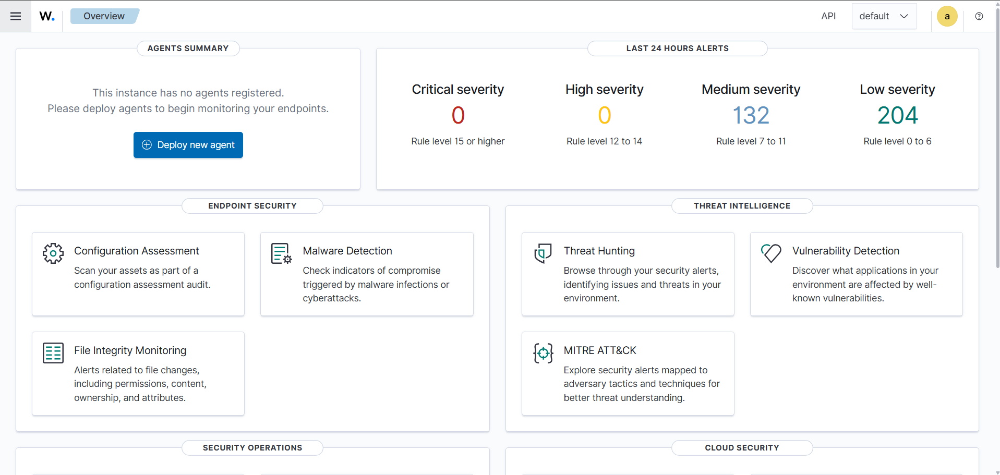
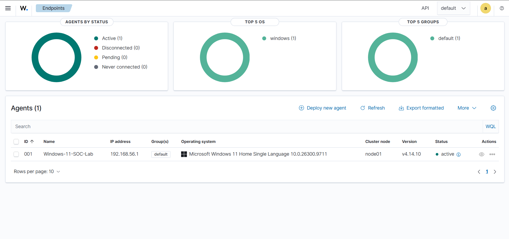
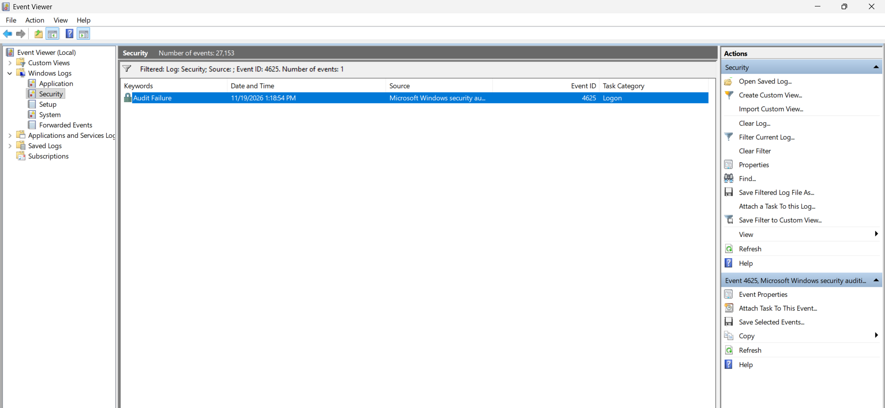
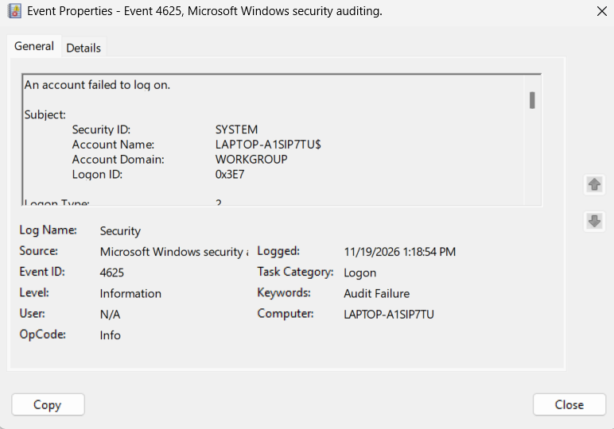
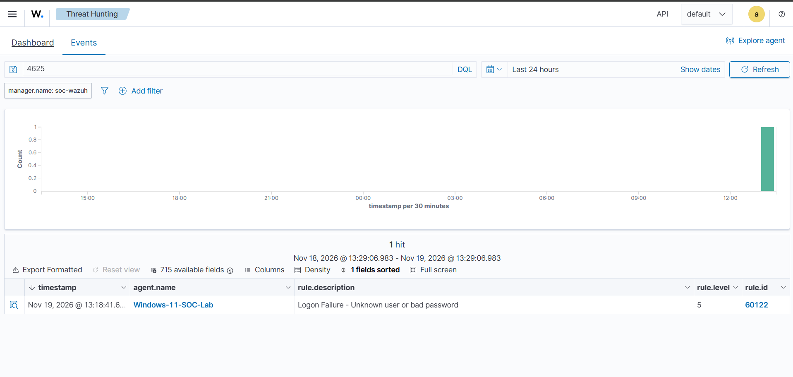

# Wazuh SOC Home Lab — Windows Endpoint Monitoring & Security Event Investigation

## Overview

This project documents the setup of a Security Operations Center (SOC) home lab using **Wazuh SIEM** to monitor a Windows 11 endpoint, collect security events, and investigate suspicious authentication activity.

The lab was deployed locally using Oracle VirtualBox and an Ubuntu Server virtual machine running the Wazuh components.

## Objectives

- Deploy a functional Wazuh SIEM environment.
- Integrate a Windows 11 endpoint using the Wazuh Agent.
- Collect and monitor Windows security events.
- Detect failed login attempts.
- Investigate security events using Wazuh Dashboard.
- Gain practical experience with SIEM monitoring and basic SOC investigation workflows.

## Lab Architecture

```text
┌───────────────────────────────┐
│       Windows 11 Host         │
│                               │
│   Windows Security Events      │
│             │                 │
│       Wazuh Agent             │
└──────────────┬────────────────┘
               │
               │ Security Logs
               ▼
┌───────────────────────────────┐
│       Ubuntu Server VM        │
│                               │
│       Wazuh Manager           │
│       Wazuh Indexer           │
│       Wazuh Dashboard          │
│       Filebeat                │
└──────────────┬────────────────┘
               │
               ▼
┌───────────────────────────────┐
│       Wazuh Dashboard         │
│                               │
│  Monitoring • Alerts • Events │
│  Security Event Investigation │
└───────────────────────────────┘
```

## Technologies Used

| Technology | Purpose |
|---|---|
| Wazuh SIEM | Security monitoring and event analysis |
| Wazuh Manager | Event analysis and security rules |
| Wazuh Indexer | Storage and indexing of security events |
| Wazuh Dashboard | Security monitoring and investigation interface |
| Wazuh Agent | Collecting endpoint data |
| Ubuntu Server | SIEM server operating system |
| Windows 11 | Monitored endpoint |
| Oracle VirtualBox | Virtualization platform |

## Implementation

### 1. Wazuh Installation

Installed the Wazuh SIEM components on an Ubuntu Server virtual machine:

- Wazuh Manager
- Wazuh Indexer
- Wazuh Dashboard
- Filebeat

Verified that the required services were running.

### 2. Windows Endpoint Integration

Installed the Wazuh Agent on the Windows 11 endpoint and configured it to communicate with the Wazuh Manager.

The endpoint was successfully enrolled and appeared as an active agent in the Wazuh Dashboard.

### 3. Security Event Monitoring

Verified that Windows security events were being collected and displayed in the Wazuh Dashboard.

### 4. Detection of Failed Logon Attempts

Investigated Windows Security Event ID:

**Event ID 4625 — Failed Logon**

This event is generated when a Windows logon attempt fails.

The event was located in Wazuh and its details were examined.

## Investigation Findings

The investigated event contained information including:

- Agent ID
- Agent name
- Event ID
- Authentication information
- Logon type
- Failure status and substatus
- Source IP information
- Process information
- Event details

The investigated event included:

| Field | Observed Value |
|---|---|
| Event ID | 4625 |
| Agent Name | Windows-11-SOC-Lab |
| Logon Type | 2 |
| IP Address | 127.0.0.1 |
| Process | `C:\Windows\System32\svchost.exe` |

Event ID 4625 can be associated with incorrect credentials, failed authentication attempts, or other authentication failures.

A single failed logon is not sufficient to conclude that an attack occurred. Further investigation and correlation with additional events would be required.

## Screenshots

### 1. Wazuh Dashboard
Initial Wazuh dashboard showing security alert overview before endpoint registration.



### 2. Windows Endpoint Connected
Windows 11 endpoint successfully registered and active in Wazuh.



### 3. Failed Logon Event in Windows Event Viewer
Windows Security Event ID 4625 generated during a controlled failed authentication test.



### 4. Windows Event Details
Detailed investigation of Event ID 4625, including logon information and failure details.



### 5. Wazuh Detection
Wazuh detected the failed logon and generated an alert:
- Rule ID: 60122
- Rule Level: 5
- Alert: Logon Failure - Unknown user or bad password



## Skills Practiced

- SIEM deployment
- Endpoint monitoring
- Windows security event analysis
- Log collection and analysis
- Security event investigation
- Basic authentication failure analysis
- Virtual machine configuration
- Linux service management
- SOC monitoring workflow

## Learning Outcomes

Through this project, I gained hands-on experience deploying a SIEM environment, integrating an endpoint, collecting security logs, and investigating Windows authentication events.

This project represents the foundation of my practical SOC Analyst learning journey.

## Future Improvements

Planned enhancements to the lab include:

- File Integrity Monitoring (FIM)
- Detection of repeated failed login attempts
- Investigation of suspicious process execution
- Additional Windows security event investigations
- Custom detection rules
- Incident investigation documentation
- Further endpoint monitoring scenarios

## Disclaimer

This lab was created for educational purposes in a controlled environment. Security events were investigated on my own lab systems.

---

**Author:** Cybersecurity Learner  
**Project:** Wazuh SOC Home Lab  
**Focus:** SIEM • Windows Endpoint Monitoring • Security Event Investigation
